# Baseline Metrik DORA — TetangGo

> Latihan 1.3 — DevOps Fase 1, Bab 1
> Status: **baseline kasar, belum ada alat ukur otomatis**. Semua angka di bawah adalah
> perkiraan jujur dari Latihan 1.1, bukan hasil pengukuran.
> Ritme: 8 sprint × 2 minggu = 16 minggu. Rilis di akhir tiap sprint.
> Terakhir diperbarui: 19 November 2026

## Ringkasan

| Metrik | Baseline (awal) | Target akhir Fase 1 | Kelas DORA |
|---|---|---|---|
| Deployment Frequency | 1x / 2 minggu (0,5x per minggu) | Deploy kapan saja, ≥ 1x per minggu | Medium → High |
| Lead Time for Changes — perubahan kecil | ~1 hari | < 1 hari (target < 4 jam) | High → Elite |
| Lead Time for Changes — perubahan besar | ~6 hari | ≤ 3 hari | High → High |
| Change Failure Rate | Belum terukur (0 rilis produksi tercatat) | < 15% (maks. 1 dari 8 rilis) | — → Elite |
| Mean Time to Restore (MTTR) | Belum terukur; estimasi 2–4 jam | < 1 jam + runbook tertulis | — (est. High) → Elite |

Kelas DORA mengacu pada acuan di Lampiran B.

## 1. Deployment Frequency

- **Baseline:** 1 deploy produksi per 2 minggu, selalu di akhir sprint.
  Selama 8 sprint (16 minggu) = **8 rilis direncanakan**.
- **Cara hitung (manual, sampai ada otomatisasi):** jumlah deploy produksi
  dibagi jumlah minggu. Catat tiap deploy di log pada bagian 5.
- **Target akhir Fase 1:** deploy **tidak lagi terikat akhir sprint** — bisa
  kapan saja saat perubahan siap (on-demand), minimal 1x per minggu.
  Prasyaratnya adalah pipeline Latihan 1.2 (Lampiran A) dan deploy staging
  yang sudah bisa dipercaya.

## 2. Lead Time for Changes

Lead time = dari commit pertama sampai perubahan hidup di produksi,
termasuk semua waktu menunggu.

### Perubahan kecil — perbaikan teks pengumuman

| Tahap | Process time | Lead time |
|---|---|---|
| Ubah teks + commit | ~30 menit | ~30 menit |
| Code review (menunggu giliran) | ~15 menit | ~2 jam |
| Deploy manual (menunggu waktu sepi warga) | ~15 menit | ~0,5 hari |
| **Total** | **~1 jam** | **~1 hari** |

### Perubahan besar — modul iuran (dari tabel Latihan 1.1)

| Tahap | Process time | Lead time | Menunggu karena |
|---|---|---|---|
| Coding modul tagihan + cron worker | 2 hari | 3 hari | Review bergantian |
| Testing & verifikasi bendahara | 0,5 hari | 2 hari | Bendahara hanya bisa malam hari |
| Deploy manual ke VPS | 1 jam | 1 hari | Menunggu waktu sepi warga |
| **Total** | **~2,5 hari** | **~6 hari** | |

Rasio efisiensi aliran (Latihan 1.1): 2,5 / 6 × 100% ≈ **43%**.
Artinya lebih dari separuh waktu habis untuk menunggu, bukan bekerja.

### Target akhir Fase 1

- Perubahan kecil: **< 1 hari**, targetnya < 4 jam (review cepat + deploy
  tidak menunggu jendela sepi, karena ada staging + smoke test).
- Perubahan besar: **≤ 3 hari** (memangkas waktu tunggu review dan deploy;
  verifikasi bendahara tetap jadi langkah manual yang dijadwalkan).

## 3. Change Failure Rate

- **Definisi "gagal":** satu deploy produksi yang memaksa hotfix, rollback,
  atau perbaikan darurat — atau yang menimbulkan insiden yang dirasakan
  warga (mis. tagihan salah, aplikasi tidak bisa dibuka).
- **Baseline: belum terukur.** TetangGo belum pernah rilis ke produksi,
  jadi belum ada pembilang maupun penyebut. Angka ini mulai terisi pada
  rilis Sprint 1.
- **Cara hitung:** (jumlah deploy gagal / total deploy) × 100%.
- **Target akhir Fase 1: < 15%** — artinya dari 8 rilis yang direncanakan,
  maksimal **1 rilis boleh gagal**. Penjaganya: unit test + `go vet` / lint
  di pipeline, migrasi staging dulu, dan smoke test `/health` sebelum
  dan sesudah deploy produksi (Lampiran A).

## 4. Mean Time to Restore (MTTR)

- **Definisi:** dari insiden terdeteksi (aplikasi down / data rusak) sampai
  layanan kembali normal untuk warga.
- **Baseline: belum terukur; estimasi kasar 2–4 jam.** Belum ada insiden
  yang pernah terjadi, belum ada prosedur restore tertulis, dan restore
  masih manual: pulihkan dari backup harian lalu restart service.
- **Target akhir Fase 1: < 1 jam, dengan prosedur restore tertulis.**
  Bahan bakunya dari Bab 2: backup PostgreSQL harian (otomatis via cron),
  service backend sebagai systemd unit yang bisa di-restart dengan satu
  perintah, dan runbook restore yang sudah pernah dicoba sekali di staging.
- **Yang harus ada sebelum target ini bisa diklaim:**
  1. Backup harian berjalan dan pernah diuji restore-nya (bukan cuma
     "file backup ada").
  2. Runbook restore tertulis (langkah demi langkah, termasuk cara cek
     hasil restore).
  3. Satu kali latihan restore di staging, dicatat waktunya.

## 5. Cara mengukur — log manual sampai ada otomatisasi

Sampai Fase 3 (pipeline CI/CD) jadi, pengukuran dilakukan manual:
setiap selesai deploy, isi satu baris tabel ini.

| Sprint | Tanggal rilis | Perubahan | Lead time | Deploy gagal? | MTTR (jika ada insiden) |
|---|---|---|---|---|---|
| 1 | | | | | |
| 2 | | | | | |
| 3 | | | | | |
| 4 | | | | | |
| 5 | | | | | |
| 6 | | | | | |
| 7 | | | | | |
| 8 | | | | | |

Aturan main:

- Review tabel ini tiap akhir sprint; kalau ada angka yang ternyata jauh
  dari baseline, perbarui baseline-nya dan tulis alasannya di bawah tabel.
- Change Failure Rate dan MTTR baru punya angka setelah rilis Sprint 1.
  Sebelum itu, tulis "belum terukur" — jangan diisi nol, karena nol
  berarti "tidak pernah gagal", bukan "belum diukur".

## Lampiran A — Pipeline CI/CD ideal backend Go TetangGo (Latihan 1.2)

Urutan wajib tahap pipeline:

```mermaid
flowchart LR
    A[Commit] --> B[Build]
    B --> C[Unit test]
    C --> D[go vet & lint]
    D --> E[Build binary]
    E --> F[Migrasi DB staging]
    F --> G[Deploy staging]
    G --> H[Smoke test /health]
    H --> I[Approval manual]
    I --> J[Deploy production]
    J --> K[Verifikasi /health]
```

| Tahap | Pemicu | Alat | Kondisi gagal → pipeline berhenti |
|---|---|---|---|
| Commit | Push ke branch | Git | — |
| Build | Setiap commit | `go build` | Build error → berhenti, tidak ada binary |
| Unit test | Setelah build lolos | `go test ./...` | Ada test gagal → berhenti, binary tidak lanjut |
| go vet & lint | Setelah unit test lolos | `go vet`, golangci-lint | Temuan vet/lint → berhenti |
| Build binary | Setelah vet & lint lolos | `go build -o tetanggo` | Build error → berhenti |
| Migrasi DB (staging) | Binary siap | `migrate` / `psql` | Migrasi gagal → berhenti, staging tidak di-deploy |
| Deploy staging | Migrasi staging lolos | systemd / scp + restart | Service staging tidak jalan → berhenti |
| Smoke test /health | Staging ter-deploy | `curl /health` | Health check gagal → berhenti, tidak lanjut ke production |
| Approval manual | Smoke test lolos | Manual (pemilik rilis) | Tidak disetujui → berhenti, tunggu perbaikan |
| Deploy production | Approval diberikan | systemd / scp + restart | Service production tidak jalan → rollback (lihat bawah) |
| Verifikasi /health | Production ter-deploy | `curl /health` | Health check gagal → rollback |

**Strategi rollback (satu kalimat):** kembalikan binary ke versi sebelumnya
dan jalankan migrasi balik yang reversible, lalu verifikasi `/health` lagi.

**Status otomatisasi hari ini:** seluruh tahap di atas masih manual di
TetangGo. Prioritas otomatisasi: (1) build + unit test, (2) `go vet` & lint,
(3) deploy staging + smoke test, (4) migrasi staging, (5) deploy production.

## Lampiran B — Acuan kelas DORA

| Metrik | Elite | High | Medium | Low |
|---|---|---|---|---|
| Deployment Frequency | Beberapa kali per hari | 1x per hari – 1x per minggu | 1x per minggu – 1x per bulan | 1x per bulan – 1x per 6 bulan |
| Lead Time for Changes | < 1 hari | 1 hari – 1 minggu | 1 minggu – 1 bulan | 1 bulan – 6 bulan |
| Change Failure Rate | 0–15% | 16–30% | 31–45% | 46–60% |
| Mean Time to Restore | < 1 jam | < 1 hari | 1 hari – 1 minggu | 1 minggu – 1 bulan |
